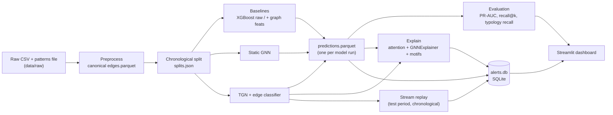
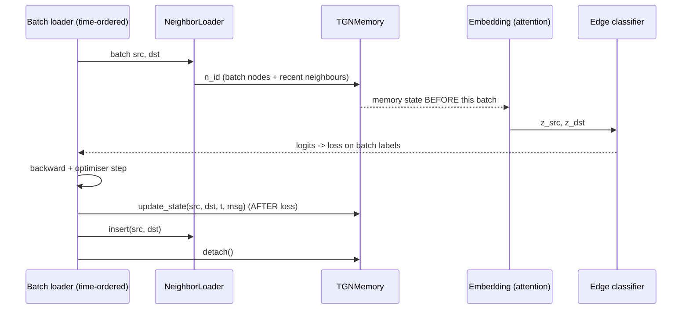
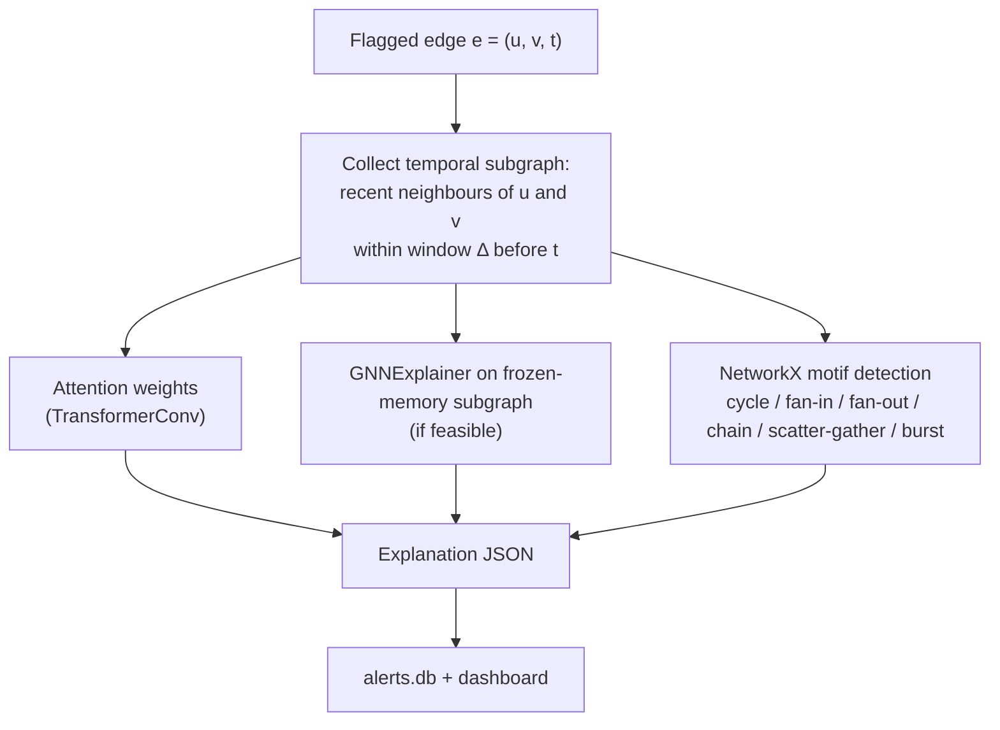
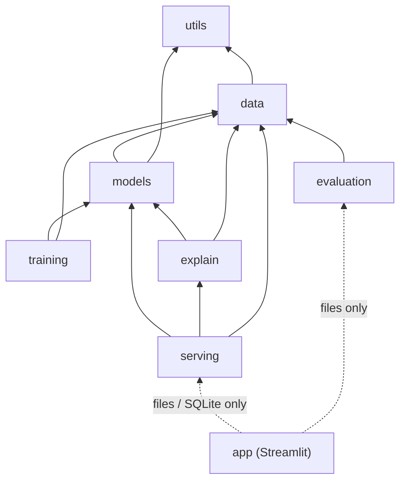

# ARCHITECTURE

System design for **TGNN-Fraud**. This document is the source of truth for module boundaries, data contracts and
build order. If code and this document disagree, fix one of them in the same pull request.

Contents: 1 Purpose · 2 System overview · 3 Repository layout · 4 Data layer · 5 Feature engineering ·
6 Models · 7 Training and prediction contracts · 8 Explainability · 9 Serving and alert store ·
10 Dashboard · 11 Configuration and reproducibility · 12 Compute and deployment · 13 Module dependency rules ·
14 Testing · 15 Risks · 16 Build order and acceptance criteria · 17 Decision log · 18 Open questions

---

## 0. Active delivery scope: v1 prototype

README.md defines the active prototype scope. This document retains detailed data/model contracts and future research design; optional final-version modules below are not v1 requirements.

**Required now:** a verified contiguous HI-Small subset, one XGBoost transaction-feature baseline, one TGN, AP/precision/recall/F1, bounded historical context with basic cycle/fan-out detection, saved alerts, and Streamlit queue/detail pages.

**Deferred:** graph-feature baseline, static GNN, ablations, multi-seed/full-data runs, typology/explanation benchmarks, GNNExplainer/SHAP, inference replay controls, extra pages, Docker and APIs.

Prototype demo mode reads saved predictions and explanations. Labels and pattern ground truth are used only for evaluation, never scoring. If a pattern file is missing/unmatched, do not block basic motif displays or invent typology results.

### Prototype data and model safeguards
- Record a reproducible contiguous subset, source checksum, split boundaries and per-split positive counts. Preserve all events in the interval.
- Keep equal timestamps together at split boundaries. With strictly-before history, score all events at a timestamp before inserting any of them into history; chunking must not expose same-time events.
- Exclude label, attempt_id and typology from inputs/messages. An ID index can include unseen nodes for addressing only, not future-derived attributes.
- On loading the chosen checkpoint for held-out evaluation, reset memory/neighbour state and warm history with that checkpoint; continue across evaluation split boundaries without resets or parameter updates.
- Use average_precision_score and label the metric **AP**. Existing PR-AUC research wording must specify its integration convention before final reporting.
- Freeze a numeric validation-selected threshold for v1. Fixed-threshold alerts and top-k ranking metrics are distinct policies.
- Historical explanation edges precede the target timestamp. Display the target edge separately so it can complete a motif, and label motif facts as descriptive context.
- Attention must be captured/reconstructed at prediction time with matching checkpoint/history. A motif or attention weight alone does not establish causal attribution.
- Bound context by configurable time window, hops and maximum edges; full-graph cycle enumeration is not a prototype requirement.
- Required checks are split/timestamp ordering, future and label leakage, memory ordering, prediction schema, motifs and a tiny end-to-end demo.

### Prototype integration boundaries
The data owner produces canonical files; model owners produce the common prediction schema; evaluation/context consumes these outputs; the dashboard reads saved files and SQLite only. TGN owner owns scorer/memory lifecycle. Dashboard owner owns storage and integration. Names remain unassigned until the team agrees.

---

## 1. Purpose

Detect **coordinated** financial fraud (chains, cycles, fan-in/out, scatter-gather, bursts) by classifying each
transaction with a Temporal Graph Network, explain each alert, and present alerts to an investigator.

Success is defined by the research questions in `README.md` section 2 (RQ1 to RQ4). Anything that does not serve
one of them is a stretch item.

## 2. System overview



Design principles:

1. **File-based interfaces between stages.** Each stage reads files and writes files. Stages do not import each
   other's internals, so teammates can work in parallel.
2. **One prediction schema for every model.** Evaluation, explanation and the dashboard are model-agnostic.
3. **Time is a first-class constraint.** No operation may use information from the future of the event being scored.
4. **Small by default.** Training runs on a free GPU; the demo runs on CPU.

## 3. Repository layout

```
src/tgnn_fraud/
├── data/
│   ├── download.py        # verifies raw files exist; prints Kaggle instructions (no credentials stored)
│   ├── preprocess.py      # raw CSV -> edges.parquet, node_index.parquet, patterns matched to edges
│   ├── splits.py          # chronological split -> splits.json
│   ├── features.py        # static edge features + causal windowed graph features
│   └── event_stream.py    # TemporalData / batch iterator over sorted events (no shuffling)
├── models/
│   ├── baselines.py       # XGBoost wrappers (raw, +graph features)
│   ├── static_gnn.py      # GraphSAGE/GAT edge classifier on time-window snapshots
│   ├── tgn.py             # TGNMemory + GraphAttentionEmbedding + LastNeighborLoader glue
│   └── edge_classifier.py # MLP head: [z_src, z_dst, edge_feats] -> logit
├── training/
│   ├── train_baselines.py
│   ├── train_tgn.py
│   ├── train_static_gnn.py
│   └── losses.py          # weighted BCE, focal loss
├── evaluation/
│   ├── metrics.py         # PR-AUC, F1, precision/recall@k, threshold selection
│   ├── typology.py        # per-typology recall using patterns file
│   ├── explanation_eval.py# overlap of explained edges with ground-truth pattern edges
│   └── run_eval.py        # reads predictions.parquet -> metrics.json, figures
├── explain/
│   ├── attention.py       # extract TransformerConv attention for a target edge
│   ├── gnn_explainer.py   # GNNExplainer on frozen-memory subgraph (feasibility-gated)
│   ├── motifs.py          # NetworkX: cycle, fan-in/out, chain, scatter-gather, burst
│   ├── report.py          # merge into explanation JSON
│   └── run_explain.py     # top-K alerts -> alerts.db
├── serving/
│   ├── replay.py          # chronological replay of test events in micro-batches
│   ├── scorer.py          # load checkpoint, maintain memory, score batches
│   ├── alert_store.py     # SQLite read/write
│   └── build_demo_bundle.py
└── utils/
    ├── config.py          # YAML loading + validation (dataclasses or pydantic)
    ├── seed.py            # global seeding
    └── logging.py

app/
├── Home.py                # overview + model comparison
└── pages/
    ├── 1_Alert_Queue.py
    ├── 2_Alert_Detail.py
    ├── 3_Replay_Simulator.py
    └── 4_Model_Comparison.py
```

## 4. Data layer

### 4.1 Raw input (assumed; verify after download)

IBM AMLworld, HI-Small: a transactions CSV and a patterns text file. Expected transaction columns:

`Timestamp, From Bank, Account, To Bank, Account, Amount Received, Receiving Currency, Amount Paid, Payment Currency, Payment Format, Is Laundering`

Note the two columns both named `Account`; pandas will rename the second to `Account.1`. `preprocess.py` must rename
columns explicitly and assert the expected set. If the real file differs, update this section and `preprocess.py`
together.

The patterns file lists each laundering attempt (with its typology) followed by the transactions that belong to it.

### 4.2 Canonical edge table: `data/processed/edges.parquet`

Sorted by `(ts, original_row)`; `edge_id` is the position after sorting and is **stable**.

| Column | Type | Notes |
|--------|------|-------|
| `edge_id` | int64 | 0..N-1 after sort |
| `ts` | int64 | seconds since dataset start |
| `src`, `dst` | int32 | node indices from `node_index.parquet` |
| `from_bank`, `to_bank` | category/int | |
| `amount_paid`, `amount_received` | float64 | raw values |
| `currency_paid`, `currency_received` | category | |
| `payment_format` | category | |
| `label` | int8 | 1 = laundering (`Is Laundering`) |
| `attempt_id` | int32 (nullable) | laundering attempt from patterns file; null for normal edges |
| `typology` | category (nullable) | cycle, fan-in, fan-out, scatter-gather, ... |

Matching pattern transactions to edges requires joining on (timestamp, accounts, amounts). If a pattern row cannot
be matched uniquely, log it and keep a count in `data/processed/preprocess_report.json`. Typology-based metrics
only use matched edges.

### 4.3 Node index: `data/processed/node_index.parquet`

`node_id` (int32), `bank`, `account` (original identifiers). A node is the unique `(bank, account)` pair.

### 4.4 Split: `data/processed/splits.json`

```json
{ "train_end_ts": 0, "val_end_ts": 0,
  "train_edges": [0, 0], "val_edges": [0, 0], "test_edges": [0, 0],
  "fractions": [0.6, 0.2, 0.2] }
```

Split by **timestamp quantile** on the sorted edge table. Store edge-id ranges. All later code reads these ranges;
nobody re-splits.

### 4.5 Rules

- Fit encoders and scalers on **train edges only**; save them to `data/processed/transformers.pkl`.
- Unseen categories at val/test map to an "unknown" bucket.
- Nodes that first appear in val/test are valid: TGN memory starts at zero for them (this is the inductive case).
- `data/` is gitignored. Only `data/demo/` may be shared, and only if small.

## 5. Feature engineering

### 5.1 Static edge features (used by every model)

`log1p(amount_paid)`, `log1p(amount_received)`, same-currency flag, same-bank flag, payment format (one-hot),
currency (one-hot or embedding index), time-of-day and day-of-week encodings if informative.

### 5.2 Causal windowed graph features (baseline B2 only)

For each edge at time `t`, features about `src` and `dst` computed from **events strictly before `t`**:

- in/out transaction count and amount sums over windows (1h, 6h, 24h; configurable)
- number of unique counterparties
- time since the account's last transaction
- in/out amount ratio

Implementation must be causal: use a single pass over the time-sorted stream with per-account state, or
`groupby().rolling(..., closed="left")`. Add a unit test that perturbs future edges and asserts features at `t`
do not change (section 14).

This baseline exists so TGN is compared against a model that also sees graph context. Without it, RQ1 is unfair.

## 6. Models

### 6.1 Baselines

| ID | Model | Inputs |
|----|-------|--------|
| B1 | XGBoost | static edge features |
| B2 | XGBoost | static edge features + causal windowed graph features |
| B3 | Static GNN (GraphSAGE or GAT) | rolling time-window snapshots; edge classification head; **no** time encoding, **no** memory |

### 6.2 TGN (main model)

Built on PyG's TGN components, adapted from link prediction to **edge classification**.

| Component | Role | Starting config (tune later) |
|-----------|------|------------------------------|
| `TGNMemory` | per-node memory updated by events | memory_dim 100, time_dim 100, `IdentityMessage`, `LastAggregator` |
| `LastNeighborLoader` | most recent neighbours per node | size 10 |
| `GraphAttentionEmbedding` (`TransformerConv`) | embeddings from memory + neighbour events + time encoding | out_channels 100, heads 2 |
| `EdgeClassifier` | MLP on `[z_src, z_dst, edge_feats]` | hidden 128, dropout 0.2 |
| Loss | weighted BCE (`pos_weight` from train class ratio) or focal | |
| Optimiser | Adam | lr 1e-4 to 1e-3, tune |

Raw message for memory = static edge features (never the label).

#### Training step (per batch, chronological, no shuffling)



Rules that prevent leakage and silent bugs:

1. **Predict first, update memory after.** A batch's events influence only later batches.
2. **No shuffling.** Batches are consecutive slices of the sorted edge table.
3. **Reset memory and neighbour loader at the start of each training epoch.**
4. **Do not reset between train, val and test evaluation.** Evaluate val continuing from the end of train state,
   then test continuing from the end of val state (no gradients, but memory keeps updating).
5. **Labels never enter messages, features or memory.**
6. Batch size is a trade-off: larger is faster but coarser memory updates. Start at 200, try up to 1024.

### 6.3 Ablations (RQ2)

| ID | Variant | What it tests |
|----|---------|---------------|
| A0 | Full TGN | reference |
| A1 | No memory (embedding module over neighbours only) | value of long-term node state |
| A2 | No time encoding | value of continuous-time information |
| A3 | Neighbour size sweep (5, 10, 20) | context size |
| A4 | TGAT-style (stretch) | alternative temporal model |

Each ablation is a config flag, not a code fork.

## 7. Training and prediction contracts

### 7.1 Class imbalance

Illicit edges are roughly 0.1% of data. Use `pos_weight` or focal loss. Do not subsample edges in a way that breaks
the chronological stream. Report PR-AUC as the primary metric.

### 7.2 Run folder

Every training run creates `runs/<YYYYmmdd_HHMM>_<name>/`:

```
config.yaml            # resolved config (copy)
seed.txt
checkpoint_best.pt     # chosen by val PR-AUC (GNNs only)
model.json             # XGBoost models
predictions.parquet    # see 7.3
metrics.json           # produced by evaluation
tb/                    # TensorBoard logs
```

### 7.3 `predictions.parquet` (the universal interface)

| Column | Type | Notes |
|--------|------|-------|
| `edge_id` | int64 | joins to `edges.parquet` |
| `split` | category | train / val / test |
| `score` | float32 | model risk score; not assumed calibrated |
| `label` | int8 | copied for convenience |
| `model` | category | b1, b2, b3, tgn, tgn_no_memory, ... |
| `run_id` | string | |

Predictions are saved for val and test (train optional).

### 7.4 Thresholding and metrics

- Threshold options: (a) max F1 on val; (b) top-k% alert budget (default 0.5%). Freeze on val, apply to test.
- Metrics: PR-AUC, ROC-AUC, F1, precision, recall (illicit class), precision@k and recall@k, per-typology recall,
  inference time per batch.
- Final comparison: at least 3 seeds, report mean and standard deviation.

## 8. Explainability

Goal: for any alert, answer "why was this flagged?" in terms an investigator understands.



### 8.1 Methods

| Method | Role | Status |
|--------|------|--------|
| Attention weights | **Primary.** Edge importance in the embedding step | Must |
| Motif detection (NetworkX) | **Primary.** Names the pattern: e.g. simple cycles up to length 6, fan-in/out above degree threshold, scatter-gather, bursts by z-score of tx counts | Must |
| GNNExplainer | Secondary. Wrap embedding module + head with memory state frozen as node features | Should, feasibility-gated (section 18) |
| SHAP | Baseline B1/B2 only, for feature importance comparison | Should |

### 8.2 Explanation JSON (stored in `alerts.db`)

```json
{
  "edge_id": 123456,
  "score": 0.93,
  "threshold": 0.71,
  "window_seconds": 21600,
  "subgraph": {
    "nodes": [{"node_id": 1, "label": "bank:account"}],
    "edges": [{"edge_id": 1, "src": 1, "dst": 2, "ts": 1000, "amount": 5400.0,
               "attn": 0.31, "gnnexp": null}]
  },
  "motifs": [{"type": "cycle", "node_ids": [1, 2, 3, 4], "edge_ids": [1, 5, 9, 12], "span_seconds": 18000}],
  "summary": "4-account circular flow completed within 5 hours; amounts nearly preserved around the cycle."
}
```

`summary` is generated from templates filled with motif and attention facts. Do **not** use an LLM to generate
explanations of model behaviour; explanations must come from the model and graph.

### 8.3 Explanation evaluation (RQ4)

Using the patterns file, each laundering attempt has a ground-truth edge set. For flagged true positives, compare the
top-k explained edges with the attempt's edges: precision@k and recall@k. Compare methods in README table 10.3.

## 9. Serving and alert store

### 9.1 Replay

`serving/replay.py` iterates test-period events in chronological micro-batches, calls `scorer.py`, and writes
alerts to SQLite when `score >= threshold`. This **simulates** streaming; it is not a production service.

`scorer.py` loads the checkpoint, warms memory by running train and val events with no gradients (or loads a saved
memory snapshot), then scores new batches and updates memory after scoring.

### 9.2 SQLite schema

```sql
CREATE TABLE alerts (
  alert_id   INTEGER PRIMARY KEY,
  edge_id    INTEGER NOT NULL,
  ts         INTEGER NOT NULL,
  src        INTEGER NOT NULL,
  dst        INTEGER NOT NULL,
  amount     REAL,
  score      REAL NOT NULL,
  label      INTEGER,              -- ground truth; shown only in demo/eval mode
  run_id     TEXT NOT NULL,
  status     TEXT DEFAULT 'new',   -- new | reviewed | confirmed | dismissed
  created_at TEXT DEFAULT CURRENT_TIMESTAMP
);
CREATE TABLE explanations (
  alert_id   INTEGER PRIMARY KEY REFERENCES alerts(alert_id),
  json       TEXT NOT NULL
);
```

### 9.3 Optional FastAPI (stretch)

If added, it wraps `scorer.py` with `POST /score` and `GET /alerts`. It must not contain model logic.

## 10. Dashboard (Streamlit)

| Page | Content | Data source |
|------|---------|-------------|
| Home | Project summary, headline metrics, model comparison chart | `reports/*.json` |
| Alert Queue | Table sorted by score; filters (score, time, account, status) | `alerts.db` |
| Alert Detail | PyVis subgraph (edge width = attention), Plotly timeline of transactions, motif list, explanation text, status buttons | `alerts.db`, `edges.parquet` |
| Replay Simulator | Play/pause stream, live alert counter, score distribution | `serving/replay.py` |
| Model Comparison | PR curves, typology recall bar chart, ablation table | `reports/` |

Rules: the app reads files and the database only; it never trains models or imports from `models/` or `training/`.
Embed PyVis HTML with `streamlit.components.v1.html`. Cache data loads with `st.cache_data`. Ground-truth labels are
shown only in "demo/evaluation mode" with a clear banner.

## 11. Configuration and reproducibility

- All hyperparameters live in `configs/*.yaml`. No magic numbers in code.
- `utils/seed.py` seeds Python, NumPy, PyTorch (CPU and CUDA). Record the seed in the run folder.
- Pin dependency versions in `requirements.txt` once the environment works. Record `torch`, `torch_geometric` and
  CUDA versions in each run's `config.yaml`.
- Every figure in `reports/` must be regenerable from a run folder with one command.

## 12. Compute and deployment

| Task | Where |
|------|-------|
| Development and unit tests | Laptop, CPU, tiny synthetic dataset |
| Preprocessing and baselines | Laptop or Colab |
| TGN training | Colab / Kaggle GPU |
| Dashboard demo | Docker on CPU using `data/demo/` bundle |

**Demo bundle** (`data/demo/`): a slice of the test period (about 50k events chosen to include several laundering
attempts of different typologies), the checkpoint, node index, `alerts.db` with explanations. Keep it small enough
to commit or host on cloud storage.

## 13. Module dependency rules



- `evaluation` depends only on `predictions.parquet` and `edges.parquet`, never on model code.
- `app` must not import `models` or `training`.
- No circular imports. `utils` imports nothing from the project.

## 14. Testing

| Test | Purpose |
|------|---------|
| Tiny synthetic dataset (about 2k edges with planted cycle and fan-out) | Fast smoke test of the whole pipeline in under a minute |
| Split test | Train max timestamp < val min timestamp < test min timestamp |
| Leakage test | Perturb future edges; features and scores at time `t` must not change |
| Memory-order test | Scores for a batch are identical whether or not later batches exist |
| Determinism test | Same seed gives same loss on a few batches (CPU) |
| Schema test | `predictions.parquet` has required columns and no NaN scores |
| Motif tests | Planted cycle/fan-out detected by `motifs.py` |
| Explanation JSON test | Validates against schema in 8.2 |

Run with `pytest`. Add a test with every bug fix.

## 15. Risks and mitigations

| Risk | Impact | Mitigation |
|------|--------|-----------|
| GNNExplainer does not fit TGN memory design | RQ4 weakened | Attention + motifs are the primary method; GNNExplainer is optional |
| TGN training too slow on free GPU | Missed milestone | HI-Small only; larger batch; fewer epochs; cache preprocessed tensors; train on Kaggle (more GPU hours) |
| Extreme class imbalance, unstable training | Poor PR-AUC | Weighted/focal loss; monitor val PR-AUC; early stopping |
| Pattern-to-edge matching is incomplete | Typology metrics partial | Report match rate; evaluate on matched edges only |
| Synthetic data criticism | Validity concerns | State limitation; optionally add Elliptic check |
| PyG / CUDA version conflicts | Lost days | Fix environment early; record versions; Colab notebook as fallback |
| Merge conflicts, unclear ownership | Slow progress | Module owners; small PRs; file-based interfaces |
| Scope creep | Unfinished core | Priority tiers in README; "Must" list first |

## 16. Build order and acceptance criteria

### v1 prototype (active)

| Milestone | Deliverable | Done when |
|---|---|---|
| P0 | Skeleton, environment, config and tiny test data | Dependency imports and smoke checks pass |
| P1 | Verified subset, causal splits, XGBoost and evaluation | Saved baseline predictions and measured metrics; data checks pass |
| P2 | TGN, checkpoint and held-out scoring | Training runs and produces genuine test scores; state-order checks pass |
| P3 | Context, basic motifs and saved alerts | Correct joins and bounded historical graphs, with honest missing-context states |
| P4 | Streamlit queue/detail and local demo | Another member can launch the demo and inspect saved outputs |

UI fixtures may be developed in parallel if labelled. Connect real outputs after P2/P3. Prototype completion does not require superior TGN performance, final comparisons or Docker.

### Final research version (deferred)
After v1: add the graph-feature baseline, static GNN, temporal ablations, multiple seeds, broader data runs, typology/explanation benchmarks and final packaging. Answer the README's deferred research questions before claiming temporal superiority or explanation faithfulness.

---

## 17. Decision log

| Decision | Choice | Reason |
|----------|--------|--------|
| Main temporal model | TGN | Native PyG support (memory, neighbour loader, example); TGAT is not a PyG module |
| Framework | PyTorch Geometric | TGN components exist; large community; explain module |
| Data store | Parquet files + SQLite | Neo4j and PostgreSQL add setup cost with no research benefit at this scale |
| Dataset | IBM AML HI-Small | Temporal, labelled edges, typology labels enable RQ3 and RQ4 |
| Node types | Accounts only | Public data has no devices/merchants; do not claim what cannot be demonstrated |
| Split | Chronological 60/20/20 | Random split leaks future information |
| Primary metric | PR-AUC | ROC-AUC is misleading at about 0.1% positives |
| Explainability | Attention + motifs primary | Works with TGN; produces human-readable output |
| UI | Streamlit only | One UI layer; FastAPI is stretch |
| Streaming | Replay simulation | Honest about scope; avoids infrastructure work |

## 18. Open questions (resolve and record in the decision log)

1. Can GNNExplainer be applied to the frozen-memory embedding module cleanly? Time-box to a few days at M4.
2. Best batch size and memory dimension for HI-Small on a free GPU.
3. Window size Δ for the explanation subgraph and motif search (the dataset covers only days, so hours are likely).
4. Exact match rate of patterns-file transactions to edges after preprocessing.
5. Whether LI-Small is run as a generalisation check or deferred.

